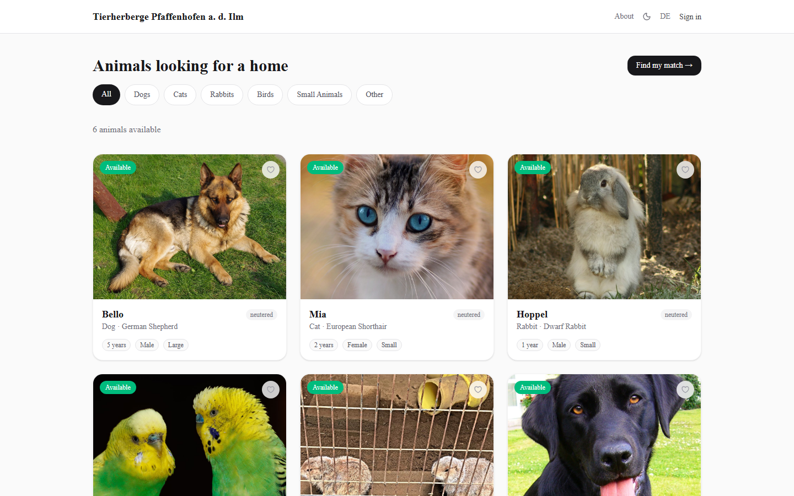

# Furbase

A management platform for animal shelters, built for a real shelter: [Tierherberge Pfaffenhofen](https://furbase.onrender.com/en). Visitors browse animals and request adoptions; staff manage animals, adoption checklists, dog-walking volunteers and incoming requests from one admin area. Available in German and English.

**Live:** [furbase.onrender.com](https://furbase.onrender.com/en) (free hosting — the first load can take up to a minute)

Built solo, from the first conversation with the shelter to the live deployment.



## Features

- **Animal catalogue** with detail pages, image upload and status tracking
- **Adoption flow** — public request form, admin review, drag-and-drop adoption checklists
- **Matcher** — a step-by-step wizard that suggests animals based on a visitor's living situation and preferences
- **Volunteer management** for dog walkers: onboarding steps, categories, contract uploads and walk scheduling
- **Admin area** for species, users, volunteers, FAQ and feedback
- Authentication, user profiles, dark mode and a locale switcher

## Tech stack

| Area | Choice |
| --- | --- |
| Web app | Next.js 16 (App Router, Server Actions), React 19, Tailwind CSS 4, shadcn/ui |
| API | Express 5, TypeScript |
| Data | PostgreSQL 16, Drizzle ORM |
| Auth | Auth.js (NextAuth v5) |
| i18n | German / English message catalogues |
| Testing | Vitest, Playwright E2E suite (auth, adoption, admin, walks, uploads, …) |
| Tooling | pnpm workspaces, Turborepo, Husky pre-commit hooks, GitHub Actions CI |

## Project structure

```text
apps/
  web/   Next.js app (public site + admin area)
  api/   Express API
packages/
  db/    Shared Drizzle schema and database access
```

## Architecture and decisions

- **Separate Express API.** Today the web app talks to the database directly through Server Actions; the API only has a health check. It is there for later: once other shelters use Furbase and their data should be connected, that layer becomes the shared interface.
- **Drizzle ORM.** Simple and lightweight. The data models are written in plain TypeScript, close to the SQL they produce, and the schema stays easy to read for humans.
- **Auth and roles.** Google sign-in via Auth.js with JWT sessions. Two roles (`user`, `admin`) live in the database and can be changed in the admin area; `ADMIN_EMAILS` is a fallback so an admin always exists, even after a database reset. Roles are checked twice: the proxy redirects non-admins away from `/admin`, and every admin Server Action and the upload route checks the role again on the server.
- **Deployment.** Render rebuilds and deploys automatically on every push to `main`. GitHub Actions runs lint, typecheck, unit and E2E tests, but it is not wired into one CI/CD pipeline with the deploy yet. A deliberately simple setup to move fast.

## Getting started

Requirements: Node.js, pnpm, Docker

```bash
pnpm install
docker compose up -d   # PostgreSQL on localhost:5435
cp apps/web/.env.example apps/web/.env   # then fill in the values below
cp apps/web/.env packages/db/.env       # the db scripts read their own .env
pnpm --filter @furbase/db db:seed        # optional: sample animals and users
pnpm dev
```

| Variable | Purpose |
| --- | --- |
| `DATABASE_URL` | PostgreSQL connection string |
| `AUTH_SECRET` | Secret for Auth.js sessions |
| `AUTH_GOOGLE_ID`, `AUTH_GOOGLE_SECRET` | Google OAuth client |
| `ADMIN_EMAILS` | Comma-separated emails that always get the admin role |

## Scripts

| Command | Does |
| --- | --- |
| `pnpm dev` | Start all apps in dev mode |
| `pnpm build` | Build all apps |
| `pnpm lint` | Lint all packages |
| `pnpm typecheck` | Type-check all packages |
